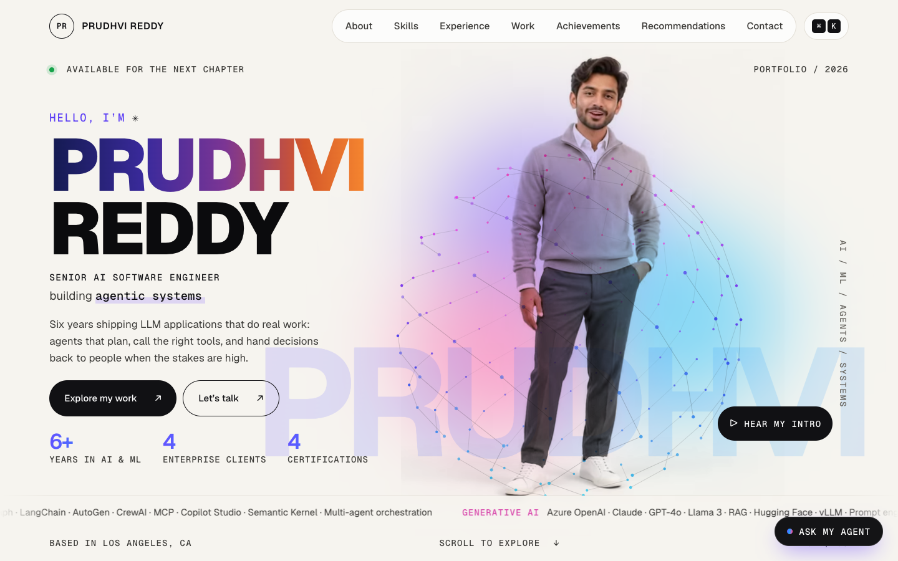

# prudhviai.online

Personal portfolio of **Prudhvi Reddy**, Senior AI Software Engineer: agentic AI, LLM applications and production ML.

**Live site:** [prudhviai.online](https://prudhviai.online)



## Highlights

- **Portfolio agent.** An "Ask my agent" chat answers questions about experience (by year or company), skills, projects and recommendations. It shows its plan → tool call → grounding trace, and it answers only from résumé data in `src/lib/data.ts`. There are no LLM calls, so it needs no API key.
- **Interactive skills.** 57 skills with real logos and filters by family (Agentic AI, GenAI, ML, Data, Backend, Frontend, Cloud). An inspector shows each skill's description and where it was used.
- **Experience.** Roles in a tabbed layout with highlights and a per-role tech stack.
- **Case studies.** Flagship AI projects written as Challenge → Solution → Architecture → Decisions → Evaluation plan, each with an animated pipeline.
- **3D and motion.** Pointer tilt with glare, a canvas "neural sphere", parallax, 3D scroll reveals, coverflow cards and magnetic buttons. Pointer effects switch off on touch devices.
- **⌘K command palette** for navigation and quick actions.
- **Accessibility.** Keyboard navigation, visible focus states, ARIA tabs and dialogs, and full `prefers-reduced-motion` support.

## Tech stack

- [Next.js 15](https://nextjs.org) (App Router) and React 19
- TypeScript
- Plain CSS with design tokens: no UI framework and no animation library
- Fonts via `next/font`, self-hosted at build time: Geist, Geist Mono and Instrument Serif
- Skill logos from [Simple Icons](https://simpleicons.org) and [Devicon](https://devicon.dev), stored locally in `public/skills/`

## Getting started

Requires Node.js 18.18 or newer.

```bash
npm install
npm run dev        # http://localhost:3000
```

Production build:

```bash
npm run build
npm start
```

## Project structure

```
src/
  app/
    layout.tsx        fonts, metadata
    page.tsx          page sections
    globals.css       design tokens, layout, 3D & motion layer
    icon.svg          favicon
  components/
    Effects.tsx       pointer tilt, parallax, scroll reveal, neural sphere, typewriter
    Assistant.tsx     "Ask my agent" chat and ⌘K command palette
    Journey.tsx       experience tabs
    Work.tsx          case-study cards and detail panel
  lib/
    data.ts           all content: profile, skills, experience, projects, recommendations
    agent.ts          the portfolio agent's question routing and retrieval
public/
  images/  resume/  skills/  video/
```

## Editing content

Almost everything lives in **`src/lib/data.ts`**:

| To change | Edit |
| --- | --- |
| Name, role, contact links | `profile` |
| Skills and families | `groups` (plus `logos` for icons) |
| Jobs and education | `experience` |
| Case studies | `caseStudies` |
| Recommendations | `testimonials` |
| Hero typing words | `focus` |

To add a 3D tilt to any element, give it `data-tilt="10"` (maximum tilt in degrees).

## Deploy

1. Import this repository into [Vercel](https://vercel.com/new) as a Next.js project.
2. In **Project → Settings → Domains**, add `prudhviai.online` and `www.prudhviai.online`.
3. Add the DNS records Vercel shows you at your domain registrar.

## Design references

These sites and patterns inspired the interactions. The site contains no code or assets from any of them.

- Apple TV / tvOS parallax icons: cursor tilt with moving glare
- Stripe and Linear: product mockups with layered 3D depth
- Bruno Simon and Lusion: 3D-first portfolio heroes (reinterpreted here as a lightweight canvas sphere)
- macOS Cover Flow: perspective carousel for achievements
